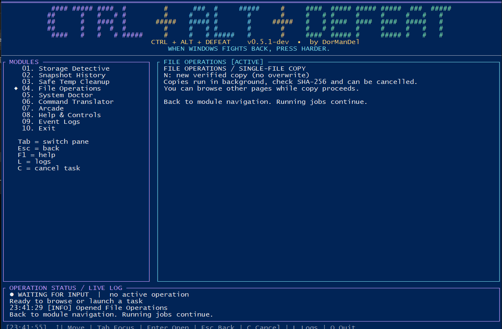

# ⌨️ Ctrl + Alt + Defeat

**When Windows fights back, press harder.**

*A slightly sarcastic, seriously useful terminal toolkit for understanding and fixing your PC.*

**Built by [DorManDel](https://github.com/DorManDel)**

[**Get started**](#-get-started) · [**Features**](#-what-can-it-do) · [**Capability Plan**](docs/CAPABILITY_PLAN.md) · [**Atlas**](docs/ATLAS.md) · [**Roadmap**](docs/ROADMAP.md) · [**Tests**](docs/TEST_PLAN.md)

> **Screenshot:** Real Windows test of the **v0.5.1** two-pane dashboard. The v0.5.2 test build adds a translator, self-test and version manager; their Windows behavior still needs validation.

## 🎯 Why does this exist?

We started by trying to understand **why deleting huge games didn't return the expected disk space**. The scripts we had were effective, but scattered. The diagnostics were useful, but lacked history, clarity and safe controls.

**The goal:** one place to *inspect, explain, preview, act and verify* — without having to remember fifty commands. Simple enough for a curious Windows user; transparent enough for a developer to trust.

## ✨ What can it do?

| Area | Current direction |
|---|---|
| 🗂️ **Storage Detective** | Browse drives, scan folders, save and compare snapshots |
| 🧹 **Cleanup** | Preview old user Temp files, explicitly approve limited deletion |
| 📁 **File tools** | Verified single-file copy with SHA-256 and cancellation |
| 📟 **Terminal dashboard** | Two panes, colored statuses, spinner, progress, event logs |
| 🛠️ **System Doctor** | Read-only diagnostics and guidance |
| 💬 **Translator** | Curated commands or optional local Ollama suggestions; **preview only** |
| 👾 **Arcade** | Optional adapters for separately installed games; not bundled |
| 🧪 **Self-test** | Automated tests and a Windows smoke-test checklist |

**Alpha, not magic:** some modules remain experimental. No unrestricted AI command execution, blanket Windows cache deletion, or guaranteed secure disk wiping. See [what works and what doesn't](docs/ATLAS.md#current-reality).

## 🚀 Get started

1. Download or clone the **development build**, then extract it into its own folder.
2. Double-click **`START-v0.5.2.vbs`** (fallback: `CtrlAltDefeat.cmd`). Review the Administrator prompt.
3. Use **↑ ↓ / Enter** to navigate, **Tab** to switch panes, **Esc** to go back, **C** to request cancellation, and **L** for logs.
4. Before trusting a new build, double-click **`RunTests.cmd`** and follow the [Windows smoke test](docs/WINDOWS_SMOKE_TEST.md).

The source build needs Python 3.10+. A standalone Windows executable is a future packaging goal. **Do not run third-party arcade executables with Administrator privileges.**

<strong>Keyboard shortcuts & where to find logs</strong>

- **↑ ↓ / Enter** — select and open
- **Tab** — switch panes · **Esc** — back, jobs continue
- **C / Ctrl+C** — request cooperative cancellation · **L** — event log
- **F1 / ?** — help · **Q** — exit safely
- Logs: `%USERPROFILE%\.ctrl_alt_defeat\logs\` (timestamped JSONL)

## 🧭 Explore the project

GitHub README files don't support native tabs, so our **[Project Atlas](docs/ATLAS.md)** acts as the navigation hub. It links to implementation details, design decisions, testing evidence, inspirations and future goals.

| Read | Why |
|---|---|
| [Atlas](docs/ATLAS.md) | All modules and references in one place |
| [Capability Plan](docs/CAPABILITY_PLAN.md) | Current actions, planned operations, risk and priorities |
| [External Adapters](docs/ADAPTER_EVALUATION.md) | What third-party tools do and how to integrate them safely |
| [AI Approval Protocol](docs/AI_ACTION_PROTOCOL.md) | Explain each command and ask before any AI-initiated action |
| [How it works](docs/HOW_IT_WORKS.md) | Code architecture and file-by-file explanation |
| [Why we built it this way](docs/DECISIONS.md) | Decisions, tradeoffs and lessons from bugs |
| [Roadmap](docs/ROADMAP.md) | What we're shipping next |
| [AI assistant vision](docs/AI_ASSISTANT_VISION.md) | Optional local-first help without unrestricted shell access |
| [Tests](docs/TEST_PLAN.md) | Automated checks versus real-Windows validation |

## 🤝 A note on safety

**Preview first. Confirm changes. Verify results.** The project keeps legacy batch scripts as historical references but never silently runs them. Some actions require elevated permissions; this is not permission for the app to delete arbitrary data.

Early build, community feedback welcome. No affiliation with Microsoft. A third-party dependency/license audit is required before stable redistribution.
